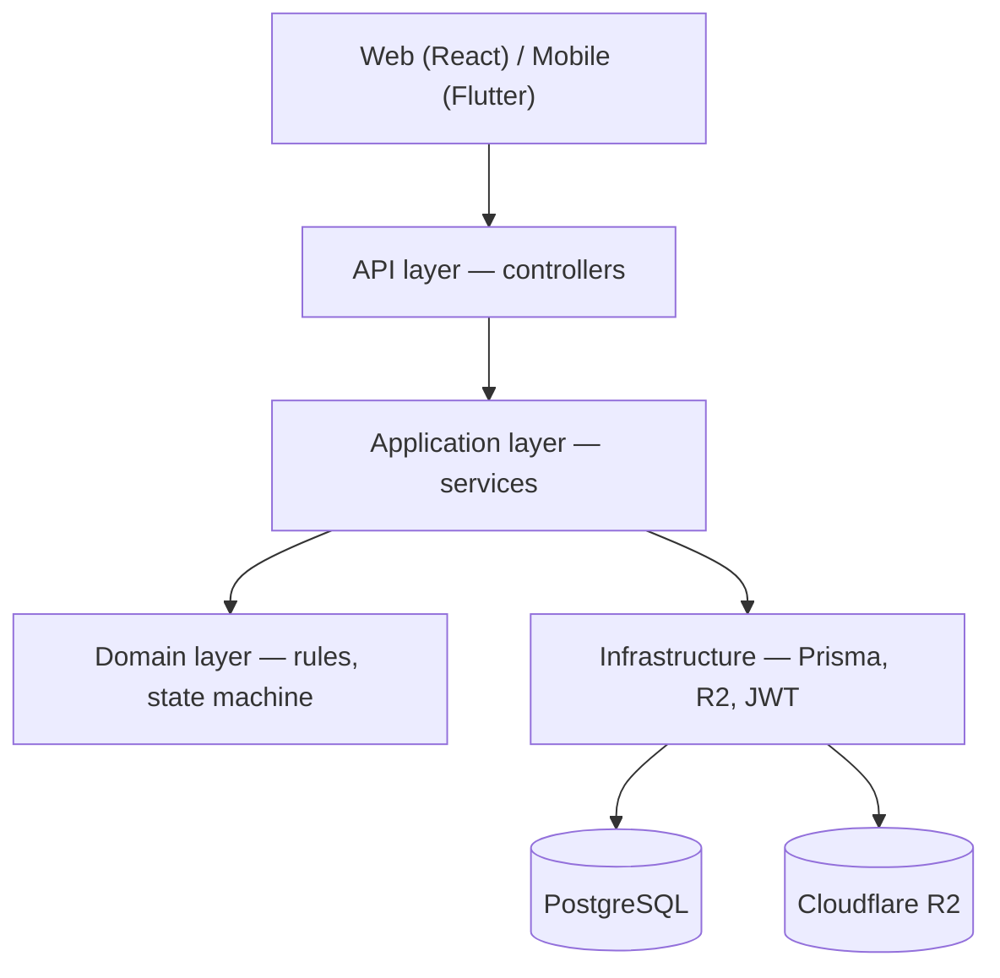
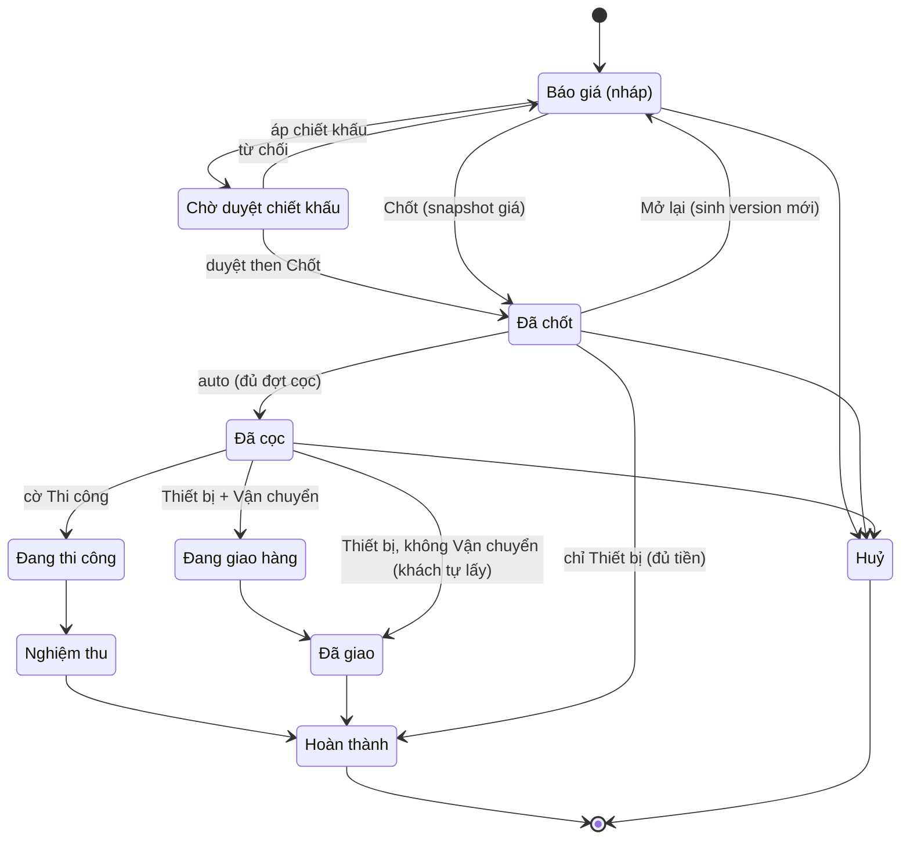
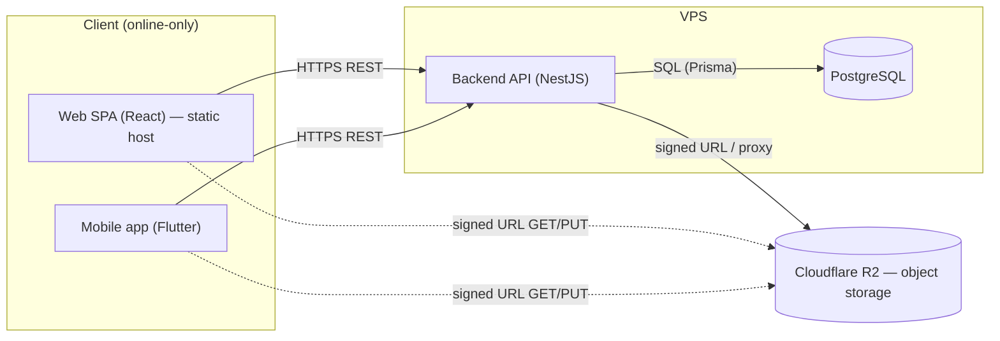

# Architecture Spine — Phương Nam Solar Phase 1

## Design Paradigm

**Layered client-server.** Backend là biên nghiệp vụ và là chủ sở hữu **DUY NHẤT** của dữ liệu; hai client (Web React, Mobile Flutter) chỉ render + gọi REST. Không client nào chạm DB hay giữ business rule.

Bốn tầng backend (ánh xạ sang NestJS module namespace):

| Tầng | Trách nhiệm | Namespace |
| --- | --- | --- |
| API (Presentation) | REST controllers, DTO/validation, OpenAPI | `*/*.controller.ts`, `common/` (guards, interceptors, exception filter) |
| Application | orchestration nghiệp vụ, transaction, auto-transition | `*/*.service.ts` |
| Domain | quy tắc thuần: pricing/VAT, snapshot, allowed-transition, permission eval | `*/domain/` (rules, state-machine, value objects) |
| Infrastructure | truy cập DB, R2, JWT | `prisma/`, `storage/`, `auth/` |

Quy tắc phụ thuộc: chảy vào trong (API → Application → Domain); Domain không phụ thuộc Infrastructure.

## Invariants & Rules



### AD-1 — Ranh giới client/server: backend là chủ DB duy nhất `[ADOPTED]`

- **Binds:** `all` (FR-1..FR-29)
- **Prevents:** FE query thẳng DB; hai nguồn sự thật; logic rò xuống client.
- **Rule:** Web và Mobile chỉ giao tiếp qua REST API. Mọi truy cập dữ liệu đi qua backend. Chỉ backend giữ credential DB.

### AD-2 — Mọi business rule thực thi ở backend `[ADOPTED]`

- **Binds:** FR-1, FR-3, FR-5, FR-7, FR-8, FR-9, FR-11, FR-12, FR-15, FR-17, FR-18, FR-25, FR-26
- **Prevents:** client tự tính giá/VAT/tồn/quyền rồi lệch với server.
- **Rule:** pricing/VAT, snapshot giá lúc chốt, chuyển trạng thái, phân quyền, tồn kho, duyệt chiết khấu — tất cả tính và quyết ở backend; client chỉ hiển thị kết quả.

### AD-3 — File/ảnh ở Cloudflare R2, không ở đĩa VPS `[ADOPTED]`

- **Binds:** FR-21, FR-23, FR-24
- **Prevents:** phình đĩa VPS; mất file khi rebuild VPS; client truy cập storage không kiểm soát.
- **Rule:** binary lưu R2 (S3-compatible). DB chỉ lưu metadata + object key. Upload/đọc qua backend (signed URL hoặc proxy); không public bucket.

### AD-4 — UI gating theo quyền, backend luôn enforce `[ADOPTED]`

- **Binds:** FR-16, FR-17, FR-18, FR-22
- **Prevents:** coi ẩn/disable ở client là lớp bảo mật; bypass quyền bằng gọi API trực tiếp.
- **Rule:** backend trả **effective permission set** qua `/me` (và khi login) để client ẩn/disable control. Nhưng backend enforce từng quyền server-side ở **mọi** request — client gating chỉ là UX.

### AD-5 — Error envelope thống nhất + xử lý lỗi tập trung `[ADOPTED]`

- **Binds:** `all`
- **Prevents:** mỗi endpoint một kiểu lỗi; FE rải rác try/catch; controller tự nặn envelope lệch shape.
- **Rule:** MỘT shape envelope `{ code, message, fieldErrors?, traceId }` + HTTP status chuẩn, trong đó `code` là **string** lấy từ một **enum mã lỗi có tài liệu**, và `fieldErrors` là `Array<{ field: string, code: string, message: string }>`. Một **exception filter trung tâm** là **nơi DUY NHẤT** tạo envelope — không controller nào tự dựng envelope bằng tay. FE handle ở MỘT chỗ (API interceptor).

### AD-6 — Đơn hợp nhất báo giá + đơn hàng `[ADOPTED]`

- **Binds:** FR-1, FR-5, FR-6, FR-10
- **Prevents:** nhân đôi dữ liệu báo giá ↔ đơn; đứt liên kết lịch sử; hai chủ sở hữu line-item; "bản hiệu lực" suy ra mập mờ theo thời điểm/số đếm.
- **Rule:** báo giá và đơn là MỘT entity `Order`, phân biệt bằng `status`. Line item thuộc về **đúng MỘT chủ sở hữu**: `OrderVersion` sở hữu **TẤT CẢ** line item; `Order` **không** sở hữu line item trực tiếp. `Order.currentVersionId` (FK → `OrderVersion`) là **con trỏ chân lý DUY NHẤT** tới bản hiệu lực; "bản hiệu lực" **không bao giờ** suy ra bằng timestamp hay số đếm version. Mọi lần đọc dòng đơn / tổng tiền đều **phân giải qua `currentVersionId`**. "Chốt" là một transition snapshot giá line-item. Sửa sau chốt = tạo `OrderVersion` mới (không ghi đè), trỏ `currentVersionId` sang bản mới, giữ lịch sử.

### AD-7 — Hybrid state machine gate theo 3 cờ phạm vi `[ADOPTED]`

- **Binds:** FR-7, FR-8, FR-9, FR-23
- **Prevents:** đơn chỉ-thiết-bị vẫn hiện bước thi công/giao hàng; chuyển bước tuỳ tiện.
- **Rule:** vòng đời đơn gate theo cờ Thiết bị/Thi công/Vận chuyển. Một số transition tự nhảy theo sự kiện nghiệp vụ (ghi đủ đợt cọc → Đã cọc); mọi transition đều permission-gated và ghi Audit.
- **Thi hành:** gate của một dòng `ALLOWED_TRANSITIONS` là điều kiện NHIỀU cờ, có phủ định (vd khách tự lấy = `{ thietBi: true, vanChuyen: false }`), diễn giải ở một hàm duy nhất `thoaCoPhamVi()`. Cạnh RA khỏi một nhánh không gate — cờ đã kiểm ở cạnh VÀO.

### AD-8 — RBAC theo từng account `[ADOPTED]`

- **Binds:** FR-16, FR-17, FR-18, FR-20
- **Prevents:** đổi định nghĩa Role hồi tố account đã tạo; mọi Admin xem được Audit.
- **Rule:** nguồn chân lý = bộ quyền lưu trên từng Account. Role = preset áp lúc tạo (nạp giá trị, không ràng buộc sau). Mô hình vai trò (Phase 1): `SUPER_ADMIN` = **người làm và vận hành app** (ngoài tổ chức khách hàng), có mọi quyền; `ADMIN` = **chủ doanh nghiệp** (khách thuê làm app); `QUAN_LY` = quản lý kinh doanh (KHÔNG phải chủ). Không tồn tại "team IT". Quyền xem Audit log (`audit.read`) là **quyền cấp được cho account bất kỳ** qua màn Phân quyền; ràng buộc bất biến chỉ nói về **preset**: không preset nào ngoài `SUPER_ADMIN` mang sẵn `audit.read` (`role-presets.ts` + test `role-presets.spec.ts`, AC-3). Endpoint Audit gate theo **quyền** `audit.read`, KHÔNG theo tên role.

### AD-9 — Khách hàng định danh bằng SĐT `[ADOPTED]`

- **Binds:** FR-29
- **Prevents:** trùng khách; SĐT không nhất quán giữa Đơn/Hợp đồng/Hoá đơn; client chuẩn hoá lệch nhau.
- **Rule:** SĐT là khoá chính của `Customer`, duy nhất toàn hệ thống, với **đúng MỘT định dạng chuẩn = E.164** (`+84…`). Chuẩn hoá **chỉ** diễn ra ở backend domain `customers`; client gửi chuỗi thô, **không bao giờ** tự chuẩn hoá. Tạo đơn tra theo SĐT (FR-29 lookup-or-create) chạy **cùng một bộ chuẩn hoá** trước khi kiểm tra tính duy nhất: trùng → dùng lại; không thấy → tạo mới tại chỗ.

### AD-10 — Tiền lưu integer minor units (đồng) `[ADOPTED]`

- **Binds:** FR-3, FR-5, FR-11, FR-12, FR-27
- **Prevents:** sai số float; lệch tổng tiền/VAT/đợt thanh toán.
- **Rule:** mọi giá trị tiền là **integer đồng** (không thập phân, không float). Tính VAT/tổng bằng số nguyên; làm tròn theo quy tắc cố định ở Domain.
- **Kiểu cột (ghi lại Epic 7, 2026-10-22):** phần lớn cột tiền là `Int` (INT4, trần ~2,147 tỉ): dòng đơn, `installments.amount`, `payments.amount`. Số do **server tự tính** (đợt theo %) không đi qua DTO nên domain phải tự chặn: `MAX_INSTALLMENT_AMOUNT` = 2.000.000.000 ⇒ 400 `amountTooLarge`, không bao giờ để driver ném 500 (Story 7.1). Tổng và thành tiền dòng của **hoá đơn** là `BigInt` (`invoices.subtotal/discount_amount/vat_amount/total`, `invoice_lines.amount`); mỗi service đổi `bigint → number` ở **một** điểm (`toView`/`toDetail`).

### AD-11 — State machine tường minh: enum + bảng transition `[ADOPTED]`

- **Binds:** FR-7, FR-8, FR-9
- **Prevents:** logic trạng thái rải rác dạng if/else; transition ngầm định không kiểm soát được; `payments/`/`inventory/` tự ghi status; guard/audit trùng lặp.
- **Rule:** trạng thái là enum tường minh; transition hợp lệ khai báo trong một **allowed-transition table** gate theo cờ phạm vi + permission. Engine là **một cặp hai nửa, một hợp đồng**: `evaluateTransition()` — hàm **thuần** ở `orders/domain/allowed-transition.ts`, **nơi duy nhất** đánh giá guard permission + cờ phạm vi — và executor `OrdersService.applyTransition(tx, {order, event, actorPermissions, actorAccountId, sentinel, occurredAt}) → StatusChanged` ở tầng Application (Domain không được phụ thuộc Infrastructure nên một hàm ở `domain/` không thể tự ghi DB). Cặp này là **con đường code DUY NHẤT** ghi `Order.status`; `payments/` và `inventory/` **gọi vào đây** qua `OrdersService.chuyenTrangThaiTuDong()` (không bao giờ ghi status trực tiếp). Từ chối ném `AppException` 403 (thiếu quyền) / 409 (ngoài bảng hoặc sai cờ), không trả rejection object. Engine **KHÔNG** gọi Audit trực tiếp — nó phát `StatusChanged` và `AuditSubscriber` ghi log (AD-18). Auto-transition và manual transition dùng **chung một entry point**; auto-transition là hệ quả của sự kiện nghiệp vụ, đi qua cùng bảng này.
- **Thi hành:** source-guard `backend/test/no-order-status-write-outside-transition.spec.ts` quét toàn `src/` — không call-site nào ngoài executor được ghi `Order.status` (Story 5.1).
- **Payment ↔ transition (quyết 2026-10-21, F-3 / TD-40):** `Payment` insert và transition tự động (`chuyenTrangThaiTuDong` / `applyTransition`) chạy trong **MỘT transaction** dưới khoá dòng đơn (`SELECT ... FOR UPDATE` trên `orders` trước tiên). Nếu transition bị chặn 409 (vd đóng đơn khi chưa xuất đủ kho — D12/AD-19), `Payment` **VẪN được commit**; transition bị bỏ qua, ghi log và publish event nghiệp vụ. Tiền khách đã trả không bao giờ bị rollback vì một gate vận hành.
  - **Hiện thực (Story 7.2):** cửa vào là `OrdersService.autoTransitionInTx(tx, …)`: chạy trong tx của caller, không mở tx, không publish, không bắt lỗi. `PaymentsService` nuốt **403 và 409** thành `skipped` (log warn + ghi trong event); mọi lỗi khác rollback cả khoản thu. Idempotency key được tra **trước** cổng trạng thái, dưới khoá.
  - **Luật mốc (quyết khi review 7.2, 2026-10-22):** `du_coc` bắn khi lần ghi làm đợt cọc đủ tiền. `hoan_thanh` bắn khi lần ghi làm **mọi** đợt đủ tiền **và** Σ đã thu ≥ tổng đơn, bất kể đợt vừa ghi là đợt nào (cạnh lên: không lần ghi nào sau đó bắn lại). Lịch 1 đợt chỉ bắn `du_coc`. Nếu cả hai mốc đạt trong một lần ghi thì thử `du_coc` rồi `hoan_thanh` trong cùng tx, và `hoan_thanh` chỉ được thử khi `du_coc` đã `applied`. Mốc `skipped` không tự bắn lại; người vận hành đóng đơn tay.

### AD-12 — API REST + OpenAPI, Auth JWT access+refresh `[ASSUMPTION]`

- **Binds:** FR-22, `all` (contract API)
- **Prevents:** lệch contract giữa backend và client; sửa tay spec làm spec lệch code; mobile không được ràng vào contract; session không revoke được.
- **Rule:** API là REST. OpenAPI spec được **SINH TỪ backend NestJS** (code là chân lý, spec là **build artifact**), được **versioned + publish** làm **hợp đồng cross-repo DUY NHẤT**; **CẢ web LẪN mobile** đều sinh/validate client dựa trên spec này (mobile cũng vậy, không chỉ web). **Cấm sửa tay** spec. Auth dùng JWT access token (ngắn hạn) + refresh token; `/me` trả effective permission set.
- **Luật client (correct-course 2026-10-22, Epic 10):** mỗi client có **MỘT composition root** (web `web/src/main.tsx`, mobile `mobile/lib/main.dart`) là nơi DUY NHẤT ráp port với adapter HTTP. Adapter dựng trên **client sinh từ `openapi.json`** (cấm khai tay type contract); client sinh có drift-guard (sinh lại phải ra đúng byte). **Chỉ tầng transport** được gọi mạng; envelope AD-5 parse ở đúng một chỗ trong transport; làm mới access token (một lần cho mọi request đang chờ) cũng chỉ ở transport. Fake port chỉ dùng trong test/demo, không được import từ composition root. Route, tham số và field DTO là tiếng Anh; enum value nghiệp vụ giữ nguyên. [Source: `sprint-change-proposal-2026-10-22.md`]
- **Luật state mobile (correct-course 2026-10-23, Epic 11):** state của màn mobile do **`flutter_bloc`** quản (Đại Ca chốt: BLoC bắt buộc, đóng H-4 retro Epic 10). Màn (widget) chỉ **render state và gửi sự kiện** (gọi method cubit hoặc `add` event); **chỉ cubit/bloc gọi port**. Cubit nhận port **qua constructor**: port đi từ composition root `mobile/lib/main.dart` → `AppPorts` → `PnsApp`/`SignedInApp` → widget màn → `BlocProvider(create: …)`; không service locator, không bloc toàn cục cho state màn. Cubit không chạm mạng (vẫn port → adapter → transport). Cubit mặc định, Bloc khi cần event; state bất biến (`Equatable`, `sealed` khi pha khác nhau). Logic cubit test bằng `bloc_test`; guard `mobile/test/screens/no_port_call_in_screens_test.dart` khoá luật (màn cũ chuyển ở Epic 11, allowlist rỗng từ 11.4; màn Epic 8/9 dựng BLoC từ đầu). [Source: `sprint-change-proposal-2026-10-23.md`]

### AD-13 — Design-system-first: một tầng design system trước mọi màn `[ADOPTED]`

- **Binds:** `all` (mọi màn Web + Mobile)
- **Prevents:** web-mobile lệch nhau; mỗi màn style riêng; drift khỏi DESIGN.md.
- **Rule:** tầng design system từ `DESIGN.md` là deliverable **ĐẦU TIÊN**, dựng cho cả hai nền tảng — thư viện component React (web) và thư viện widget Flutter (mobile) — cả hai tuân **cùng một hợp đồng thị giác** DESIGN.md (token màu, style Viền nét, 10 chip trạng thái, bộ icon SVG, topbar/botnav/frame). MỌI màn bắt buộc dùng lại component/token của design system; **cấm style ad-hoc**.

### AD-14 — Firebase mobile + push tập trung `[ADOPTED]`

- **Binds:** FR-30, FR-31, FR-32, FR-33, FR-34
- **Prevents:** business logic rò xuống Remote Config; push logic rải rác khắp service.
- **Rule:** mobile tích hợp Firebase FCM (push), Crashlytics, Analytics, Remote Config. Backend có **một** module `notifications/` gửi push qua `firebase-admin` khi có sự kiện nghiệp vụ + job nhắc theo lịch; entity `DeviceToken` gắn theo `Account` (nhiều token/account). Remote Config **CHỈ** cho config/feature-flag cấp app — **KHÔNG** thay business flag ở backend. **Cờ giá phân tầng (FR-15) vẫn lưu trên DB** — đó là nguồn chân lý nghiệp vụ, được quản lý bằng dữ liệu DB, KHÔNG bằng Remote Config. Việc **bấm cờ** (bật/tắt tính năng) được gate bởi quyền `system.feature_flags` (chỉ `SUPER_ADMIN` mang sẵn).

### AD-15 — Đích thông báo xác định theo QUYỀN, không theo role `[ADOPTED]`

- **Binds:** FR-31, FR-34, AD-8
- **Prevents:** targeting theo role (lệch khi đổi quyền); rò thông tin đơn cho account không có quyền xem; "người phụ trách/được giao" suy diễn lại lệch với bộ lọc "đơn của mình".
- **Rule:** người nhận push xác định theo **QUYỀN** (ma trận phân quyền per-account, AD-8), **KHÔNG** theo role: đẩy cho account có Quyền tương ứng **+** người phụ trách/được giao đơn. Quyền sở hữu/giao đơn định nghĩa bằng **đúng hai trường trên `Order`**: `ownerAccountId` (người tạo/phụ trách) và `assigneeAccountId` (nullable, nếu người được giao khác người tạo). **CẢ** bộ lọc permission "xem đơn của mình" (FR-17) **LẪN** việc chọn đích noti "người phụ trách/được giao" của AD-15 đều phân giải off **chính hai trường này** — một định nghĩa, hai bên tiêu thụ, không suy diễn lại. Luôn lọc theo quyền xem đơn (`orders.view_all` vs `orders.view_own`) — không đẩy nội dung đơn cho account không có quyền xem. Đổi ai giữ quyền nào thì người nhận noti tự đổi theo, không sửa cấu hình noti.

### AD-16 — Pricing & VAT: một thuật toán, một bộ tính `[ADOPTED]`

- **Binds:** FR-1, FR-3, FR-5
- **Prevents:** tổng tiền client ≠ backend; lệch giữa làm-tròn-từng-dòng và làm-tròn-trên-tổng; đổi VAT hệ thống làm sai hồi tố đơn đã chốt.
- **Rule:** ghim thuật toán tiền chính xác: `subtotal = Σ(unitPrice × qty)` theo **integer đồng**; chiết khấu (nếu có) trừ thẳng subtotal thành `vatBase = subtotal − discountAmount` — thuế tính trên số tiền thực thu; `VAT = round-half-up(vatBase × vatRate)` ở mức **GRAND-SUBTOTAL** — **MỘT điểm làm tròn duy nhất**, `vatRate` phân giải **một lần**. Đây là **hàm pricing DUY NHẤT** trong `orders/domain`. Xem trước giỏ hàng realtime (FR-1) tính bằng **CHÍNH hàm backend đó** qua endpoint stateless `POST /orders/preview-total`; client **CẤM** làm số học tiền — chỉ hiển thị integer trả về. Lúc chốt, **snapshot `vatRate` (và `vatMode`) hiệu lực** lên `OrderVersion` để việc đổi rate hệ thống sau này không sửa hồi tố đơn đã chốt.

### AD-17 — Registry quyền chính tắc: một nguồn, ba bên tiêu thụ `[ADOPTED]`

- **Binds:** AD-4, AD-8, AD-15
- **Prevents:** lệch chính tả key quyền giữa ba bên tiêu thụ (FE gating, BE guard, notification resolver); permission literal rải rác ngoài registry.
- **Rule:** **MỘT enum/registry quyền DUY NHẤT** do backend `accounts/domain` sở hữu, publish dưới dạng **artifact sinh tự động**, được **CẢ ba** bên tiêu thụ y hệt nhau: (a) UI gating ở FE, (b) request guard ở BE, (c) notification resolver của AD-15. **Không** permission string literal nào được tồn tại **ngoài** registry. "Xem tất cả đơn" và "đơn của mình" là **hai entry tường minh** trong registry.

### AD-18 — Domain event qua một EventBus port `[ADOPTED]`

- **Binds:** all (mọi hành động nghiệp vụ có hệ quả), AD-14 (notifications)
- **Prevents:** producer gọi FCM/notification trực tiếp; retrofit "gọi push" vào từng chức năng ở cuối dự án; logic side-effect rải rác.
- **Rule:** Mọi hành động nghiệp vụ có hệ quả (chốt, duyệt chiết khấu, ghi cọc/thanh toán, chuyển trạng thái, chặn xuất tồn…) **publish một domain event** qua **MỘT `EventBus` port duy nhất** (định nghĩa ở nền backend, bản đầu no-op/log). Producer **KHÔNG** gọi FCM/notification/audit trực tiếp. Các consumer (notifications gửi push theo AD-15, audit ghi log) **subscribe** port. Port + điểm publish được chừa sẵn ngay khi build mỗi chức năng; bộ gửi lắp sau không cần mở lại code chức năng.

### AD-19 — Tồn kho hai con số: onHand + reserved, StockMovement là ledger append-only `[ADOPTED]`

- **Binds:** FR-25, FR-26
- **Prevents:** một cột `reserved` cộng-trừ bị sai khi retry chốt/xuất (không idempotent); khả dụng hiển thị sai thực tế.
- **Rule:** `StockItem` có **hai con số độc lập**: `onHand` (hàng thật trong kho, chỉ phiếu nhập/xuất kho đụng vào) và `reserved` (hàng đã hứa cho đơn đã chốt). Khả dụng = `onHand − reserved`. `StockMovement` là ledger append-only theo **từng sản phẩm**: `type` ∈ `reserve` (qty > 0) / `release` / `xuat` (qty < 0, CHECK `stock_movements_qty_sign`), unique `(orderVersionId, stockItemId, type)` → chốt/re-chốt/xuất idempotent khi retry (khoá `(orderId, orderVersionId)` ban đầu không dùng được cho ledger nhiều sản phẩm — sửa ở Story 6.6; cặp đó là unique của **`StockVoucher`**: một đơn một phiếu xuất). `reserved` là **tổng của `StockMovement.qty`** trên MỌI dòng của một `stockItemId` (không lọc theo `type`), không phải một cột cộng-trừ. Giải phóng = append dòng `release`, không xoá dòng: re-chốt release version cũ rồi reserve version mới; huỷ đơn release ở cấp đơn qua subscriber `OrderCancelled` (`huyDon()` không chạm tồn); mọi cạnh vào `hoanthanh` release phần còn giữ trong cùng tx. Đơn huỷ SAU khi xuất không tự cộng tồn — lên lại qua **phiếu nhập trả** (`StockVoucher.returnOfVoucherId` → phiếu xuất gốc, `unitCost` = giá vốn gốc, tối đa một phiếu trả mỗi phiếu xuất). **Thứ tự khoá toàn hệ thống:** `orders` (FOR UPDATE) trước, `products` sau (`SELECT id FROM products WHERE id = ANY(…) ORDER BY id FOR UPDATE`). Chốt đơn khi thiếu tồn: **CHO CHỐT, không chặn**; cảnh báo sớm ở màn báo giá. Chặn nằm ở khâu **xuất kho** (FR-26). Một Đơn, một phiếu xuất. **Không đơn nào Hoàn thành khi còn vật tư theo dõi tồn chưa xuất** (Đại Ca chốt 2026-10-21): đường tắt `dachot → hoanthanh` của đơn chỉ-thiết-bị và đường đóng thi công `nghiemthu → hoanthanh` (Đại Ca mở rộng cùng ngày) bị engine chặn 409 dưới khoá dòng đơn (mọi lane, kể cả auto tất toán) tới khi đơn có phiếu xuất — một kiểm chung cho mọi cạnh vào `hoanthanh` từ trạng thái có thể chưa xuất; `dagiao → hoanthanh` không kiểm vì bước Đã giao tự xuất; cửa xuất kho riêng nhận cả `dachot` và `nghiemthu`; đơn đã xuất không mở lại (`mo_lai`) được — version mới sẽ mồ côi phiếu xuất và mở đường xuất lần hai.

### AD-20 — Hai mốc đóng băng khác nhau: giá bán lúc chốt, giá vốn lúc xuất kho `[ADOPTED]`

- **Binds:** FR-5, FR-25, FR-36, FR-37
- **Prevents:** duyệt chiết khấu thấy biên sai thực tế; báo cáo lợi nhuận bao gồm đơn chưa xuất kho; giá vốn sai khi đơn chốt lúc thiếu hàng.
- **Rule:** `OrderLineItem.unitPriceSnapshot` (giá bán) đóng băng lúc **chốt đơn lần đầu** — vì nó là **lời hứa với khách** (FR-5). `OrderLineItem.costPriceSnapshot` (giá vốn) đóng băng lúc **xuất kho** — vì nó là **sự thật**, chỉ xác định khi hàng rời kho. Hệ quả: (a) duyệt chiết khấu thấy **biên ước tính** (đọc `Product.costPrice` hiện hành), dán nhãn rõ là ước tính; (b) báo cáo lợi nhuận chỉ đọc `costPriceSnapshot`, **đơn chưa xuất kho không có trong báo cáo** — chưa xác định lãi; đơn có mặt khi có phiếu xuất và không huỷ (dòng của version gắn với phiếu xuất); doanh thu trừ chiết khấu đã duyệt, trước VAT; (c) sửa đơn đã chốt → version mới → `warrantyStartAt` đặt theo dòng, dòng cũ giữ ngày cũ, không gia hạn hết bảo hành. Bảo hành mốc từ ngày chốt đơn là quyết định có ý thức (đơn thi công chốt tháng 1, nghiệm thu tháng 4 → mất 3 tháng bảo hành).

### AD-21 — Không leo thang quyền: không cấp/sửa/vô hiệu hoá tài khoản mà mình không có quyền `[ADOPTED]`

- **Binds:** FR-17, FR-18
- **Prevents:** chủ doanh nghiệp tự cấp cho mình mọi quyền; vô hiệu hoá tài khoản Super Admin để độc chiếm app.
- **Rule:** Bất biến thi hành ở `account-permissions.service.ts` + test (tương tự `audit.read` ở `role-presets.spec.ts`): (1) **Không cấp được quyền mình không có** — `setForAccount()` phải kiểm actor có toàn bộ key yêu cầu trước khi ghi; (2) **Không sửa/vô hiệu hoá account mang quyền mà mình không có**. Hệ quả: làn ranh giữa vai trò rõ ràng, không ai tự lên quyền được.

## Consistency Conventions

| Concern | Convention |
| --- | --- |
| Đặt tên entity | PascalCase entity (`Order`, `OrderLineItem`); bảng snake_case số nhiều (`order_line_items`) |
| Đặt tên file | kebab-case (`orders.service.ts`, `allowed-transition.ts`) |
| REST route | danh từ số nhiều, kebab-case, **tiếng Anh** (`/orders/{id}/line-items`); action nghiệp vụ là sub-resource POST (`/orders/{id}/confirm`); route/tham số/field DTO tiếng Anh, enum value nghiệp vụ (khoá trạng thái, khoá event, loại khách, loại phiếu) giữ nguyên. Route/tham số tiếng Việt cũ đã đổi ở Story 10.1; field DTO đã tiếng Anh từ Story 10.2 (guard `no-vietnamese-api-contract.spec.ts` soi cả schema) |
| ID | UUID v4 cho tất cả entity, **trừ** `Customer` (PK = SĐT chuẩn hoá **E.164** `+84…`, chuẩn hoá chỉ ở backend `customers`, AD-9) |
| Ngày giờ | ISO-8601 UTC lưu trong DB; client hiển thị theo giờ VN (UTC+7) |
| Tiền | integer đồng (AD-10); không float, không decimal |
| Error shape | `{ code: string (enum có tài liệu), message, fieldErrors?: Array<{ field, code, message }>, traceId }` + HTTP status; chỉ exception filter trung tâm tạo envelope (AD-5) |
| Auth | JWT access+refresh; Bearer header; `/me` trả permission set (AD-12). Định danh đăng nhập là **SĐT** `accounts.phone` (E.164, unique) chuẩn hoá ở backend từ Story 10.9; `email` chỉ là liên hệ |
| Permission enforce | guard server-side mỗi request; client gating chỉ UX (AD-4) |
| Logging / Audit | AuditLog bất biến (ai/gì/đối tượng/khi nào/trước→sau) cho mọi mutation nghiệp vụ; append-only; đọc theo quyền `audit.read` (`GET /audit-logs`, gate theo quyền, không theo role); giá vốn trong payload (`costPrice`, `unitCost`, `giaVon…`) chỉ trả cho người có thêm `costs.view` |
| Idempotency | thao tác tiền (ghi thanh toán, chốt) idempotent, an toàn khi retry (NFR SM-1) |
| Push / Notification | người nhận resolve qua permission engine (AD-8/AD-15), không theo role; payload mang `type` + deep-link (`{ type, targetId, deeplink }`) mở đúng màn/đơn; lọc theo quyền xem đơn (AD-15) |
| **Đường đỏ: `settings.manage`** | **Quyền cấu hình hệ thống KHÔNG BAO GIỜ gate:** màn phân quyền (8.2), ma trận quyền (8.4), hay audit log (8.5). Nếu không, account có `settings.manage` sẽ tự cấp cho mình mọi quyền trong một click. Ràng buộc thi hành ở `account-permissions.service.ts` + test (tuân AD-21) |

## Stack

| Name | Version |
| --- | --- |
| Node.js | 24 LTS (Active LTS) |
| NestJS | 11.1.27 |
| PostgreSQL | 18.4 |
| Prisma ORM `[ASSUMPTION]` | 7.8.0 |
| React (Web) | 19.2.7 |
| Flutter (Mobile) | 3.44 |
| flutter_bloc (Mobile state, AD-12 luật state mobile) | 9.1.1 (+ bloc 9.2.1, equatable 3.0.0; dev bloc_test 10.0.0 — kiểm `flutter pub` trên Flutter 3.35.0 / Dart 3.9.0 thật trên máy, 2026-10-23) |
| Object storage | Cloudflare R2 (S3-compatible) |
| firebase-admin (Node, backend push) | 14.1.0 |
| Flutter Firebase — firebase_core | 4.11.0 |
| Flutter Firebase — firebase_messaging | 16.1.0 |
| Flutter Firebase — firebase_crashlytics | 5.2.4 |
| Flutter Firebase — firebase_analytics | 12.1.1 |
| Flutter Firebase — firebase_remote_config | 6.5.3 |
| Design system (per-platform, built first) | React component lib (web) + Flutter widget lib (mobile), cùng hợp đồng DESIGN.md (AD-13) |

## Structural Seed

### Core-entity ERD

```mermaid
erDiagram
    ACCOUNT ||--o{ ACCOUNT_PERMISSION : has
    PERMISSION ||--o{ ACCOUNT_PERMISSION : "granted in"
    ROLE ||--o{ ROLE_PERMISSION : presets
    PERMISSION ||--o{ ROLE_PERMISSION : "in"
    ACCOUNT }o--|| ROLE : "seeded by"
    ACCOUNT ||--o{ AUDIT_LOG : writes
    ACCOUNT ||--o{ DISCOUNT_APPROVAL : approves
    ACCOUNT ||--o{ ATTACHMENT : uploads
    ACCOUNT ||--o{ DEVICE_TOKEN : registers
    ACCOUNT ||--o{ NOTIFICATION : receives
    CUSTOMER_SOURCE ||--o{ CUSTOMER : "used by"
    CUSTOMER ||--o{ ORDER : places
    ORDER ||--o{ ORDER_VERSION : versions
    ORDER ||--o| ORDER_VERSION : "current version"
    ORDER ||--o| CUSTOMER_SOURCE : "sourceId snapshot"
    ORDER_VERSION ||--o{ ORDER_LINE_ITEM : owns
    ORDER ||--o| PAYMENT_SCHEDULE : has
    PAYMENT_SCHEDULE ||--o{ INSTALLMENT : "split into"
    INSTALLMENT ||--o{ PAYMENT : "recorded by"
    ORDER ||--o{ PAYMENT : "paid by"
    ORDER ||--o{ CONTRACT : generates
    ORDER_VERSION ||--o{ CONTRACT : "printed from"
    ORDER ||--o{ INVOICE : generates
    ORDER_VERSION ||--o| INVOICE : "invoiced once"
    INVOICE ||--o{ INVOICE_LINE : "snapshots"
    INVOICE ||--o| INVOICE_PDF : "rendered once"
    ORDER ||--o{ DISCOUNT_APPROVAL : requests
    ORDER ||--o{ ATTACHMENT : has
    ORDER ||--o{ STOCK_VOUCHER : "issue for"
    ORDER ||--o{ STOCK_MOVEMENT : "reserves/issues"
    PRODUCT ||--o{ PRODUCT_PRICE : "tiered by"
    PRODUCT ||--o{ PRODUCT_GROUP_ITEM : "items in group"
    PRODUCT ||--o{ ORDER_LINE_ITEM : "referenced by"
    PRODUCT ||--|| STOCK_ITEM : "stock of"
    PRODUCT ||--o{ STOCK_VOUCHER_LINE : moves
    PRODUCT_GROUP ||--o{ PRODUCT_GROUP_ITEM : "contains"
    STOCK_VOUCHER ||--o{ STOCK_VOUCHER_LINE : contains
    STOCK_ITEM ||--o{ STOCK_MOVEMENT : "ledger of"
    ORDER_VERSION ||--o{ STOCK_MOVEMENT : "versioning"
    ORDER {
        uuid id
        string status
        uuid currentVersionId FK
        uuid ownerAccountId FK
        uuid assigneeAccountId FK
        uuid sourceId FK
        bool scopeThietBi
        bool scopeThiCong
        bool scopeVanChuyen
        string custType
        float kWp
        string vatMode
        string cancelReason
        datetime cancelledAt
    }
    ORDER_VERSION {
        uuid id
        uuid orderId FK
        int versionNo
        int vatRate
        string vatMode
        datetime chotAt
        uuid createdByAccountId FK
    }
    ORDER_LINE_ITEM {
        uuid id
        uuid orderVersionId FK
        int unitPriceSnapshot
        int catalogPriceSnapshot
        int costPriceSnapshot
        int qty
        int warrantyMonths
        datetime warrantyStartAt
    }
    CUSTOMER {
        string sdt PK
        string custType
        uuid sourceId FK
        string sourceNote
    }
    DEVICE_TOKEN {
        uuid id
        uuid accountId FK
        string fcmToken
        string platform
        datetime createdAt
    }
    PRODUCT {
        uuid id PK
        string name
        string sku
        int costPrice
        bool tracksStock
        bool priceEditable
        int warrantyMonths
    }
    PRODUCT_PRICE {
        uuid id PK
        uuid productId FK
        int minQty
        int price
    }
    STOCK_ITEM {
        uuid id PK
        uuid productId FK "UNIQUE - một kho"
        int onHand "reserved KHÔNG là cột: = SUM(STOCK_MOVEMENT.qty)"
    }
    STOCK_VOUCHER {
        uuid id PK
        int seq "UNIQUE SERIAL - ghép mã phiếu PK-N/PK-X/PK-NT (nhập trả)"
        uuid orderId FK "nullable - phiếu xuất gắn đơn; unique cặp (orderId, orderVersionId) — một đơn một phiếu"
        uuid orderVersionId FK "nullable - cùng null/cùng có với orderId (CHECK)"
        string type "nhap | xuat (gắn đơn ⇒ chỉ xuat, CHECK)"
        uuid returnOfVoucherId FK "nullable UNIQUE - phiếu nhập trả → phiếu xuất gốc; CHECK: chỉ nhap, không mang cặp order"
        string note "không có status/phiếu nháp: tạo = xác nhận"
        uuid createdByAccountId FK
        datetime createdAt
    }
    STOCK_VOUCHER_LINE {
        uuid id PK
        uuid stockVoucherId FK
        uuid productId FK
        int qty "luôn dương, chiều theo type"
        int unitCost
    }
    NOTIFICATION {
        uuid id
        uuid accountId FK
        string type
        string payload
        string deeplink
        bool read
        datetime createdAt
    }
    CUSTOMER_SOURCE {
        uuid id PK
        string name
        string description
        bool active
        int sortOrder
        bool isOther
    }
    PRODUCT_GROUP {
        uuid id PK
        string name
        string description
        bool active
        datetime createdAt
    }
    PRODUCT_GROUP_ITEM {
        uuid id PK
        uuid productGroupId FK
        uuid productId FK
        int displayOrder
    }
    STOCK_MOVEMENT {
        uuid id PK
        uuid stockItemId FK
        uuid orderId FK
        uuid orderVersionId FK
        int qty "có dấu: giữ chỗ +, giải phóng/xuất - (CHECK theo type)"
        string type "reserve | release | xuat; UNIQUE (orderVersionId, stockItemId, type)"
        datetime createdAt
    }
    PAYMENT_SCHEDULE {
        uuid id PK
        uuid orderId FK "UNIQUE - một đơn một lịch"
    }
    INSTALLMENT {
        uuid id PK
        uuid scheduleId FK
        int seq "UNIQUE (scheduleId, seq)"
        int percent "nullable, 1..100 - XOR với số tiền gõ tay"
        int amount "đã phân giải, integer đồng; đợt đầu > 0"
        string conditionNote
        string milestone "nullable - coc | tat_toan"
    }
    PAYMENT {
        uuid id PK
        uuid orderId FK
        uuid installmentId FK
        int amount "> 0 (CHECK)"
        date paidOn "ngày VN"
        string method "bank_transfer | cash (CHECK)"
        string idempotencyKey "UNIQUE - khoá client"
        uuid recordedByAccountId FK
        datetime createdAt "append-only"
    }
    CONTRACT {
        uuid id PK
        int seq "UNIQUE SERIAL - nextval dưới khoá đơn"
        uuid orderId FK
        uuid orderVersionId FK
        string type "construction | sale (suy từ scopeThiCong, CHECK)"
        string contractNo "UNIQUE - HĐTC/HĐMB-{seq}/{yyyy}"
        string pdfKey "R2, mỗi bản một key"
        int pdfSize
        uuid createdByAccountId FK
        datetime createdAt "append-only"
    }
    INVOICE {
        uuid id PK
        int seq "UNIQUE SERIAL"
        string invoiceNo "UNIQUE - HD-{yyyy}-{NNNN}, seq toàn cục"
        uuid orderId FK
        uuid orderVersionId FK "UNIQUE - một bản đơn một hoá đơn"
        string customerSdt "snapshot khách: tên, MST, địa chỉ"
        string sellerLegalName "snapshot 7 trường pháp nhân company.* lúc lập"
        int vatRate
        bigint subtotal
        bigint discountAmount
        bigint vatAmount
        bigint total
        datetime issuedAt
    }
    INVOICE_LINE {
        uuid id PK
        uuid invoiceId FK
        int displayOrder "UNIQUE (invoiceId, displayOrder)"
        string name
        int qty "> 0 (CHECK)"
        int unitPrice
        bigint amount
    }
    INVOICE_PDF {
        uuid id PK
        uuid invoiceId FK "UNIQUE - render một lần"
        string pdfKey "invoices/{orderId}/{invoiceId}.pdf"
        int pdfSize "> 0 (CHECK)"
    }
```



### Order state machine (gate theo cờ phạm vi)



### Deployment / container



### Backend module tree (NestJS)

```text
backend/
  src/
    common/         # error envelope, exception filter, interceptors, ValidationPipe (AD-5); money/amount-in-words (dùng chung HĐ + hoá đơn)
    events/         # EventBus port (abstract kiêm DI token) + InProcessEventBus, @Global (AD-18)
    auth/           # JWT access+refresh, /me, guard quyền + decorator, reset/đổi mật khẩu (AD-4, AD-12)
    accounts/       # Account, Permission registry (SSOT), Role preset, quyền per-account (AD-8, AD-17)
    customers/      # Customer, SĐT là PK (AD-9)
    catalog/        # Product + tiered price (FR-14, FR-15)
    orders/         # Order hợp nhất, line items, versions, state machine, snapshot, chiết khấu (DiscountApproval), ảnh đính kèm (AD-6, AD-7, AD-11, AD-3, FR-18, FR-24)
    payments/       # PaymentSchedule, Installment, Payment; auto-transition trigger (FR-11, FR-12, FR-8)
    contracts/      # sinh HĐ Thi công / Mua bán → PDF (FR-13); render qua QuoteRendererPort do orders/ export
    invoices/       # Invoice + InvoiceLine (snapshot) + InvoicePdf (FR-27, FR-28); render qua QuoteRendererPort
    inventory/      # StockItem, StockVoucher(+lines), chặn xuất quá tồn (FR-25, FR-26)
    settings/       # SystemSetting — VAT mặc định, pháp nhân công ty `company.*` (7 key, seed rỗng; in trên HĐ, snapshot vào hoá đơn)
    feature-flags/  # FeatureFlag — bấm cờ, gate bởi `system.feature_flags` (AD-14)
    health/         # health check
    openapi/        # openapi-document.ts — spec là build artifact sinh từ code (AD-12)
    audit/          # AuditLog append-only, đọc theo quyền `audit.read` (FR-20)
    notifications/  # FCM sender qua firebase-admin, DeviceToken registry, Notification inbox, nhắc theo lịch (cần job scheduler, vd NestJS Schedule/cron); người nhận resolve qua permission engine (AD-14, AD-15, FR-30..34)
    dashboard/      # doanh thu / đếm đơn theo trạng thái (FR-19)
    prisma/         # PrismaService — điểm truy cập DB duy nhất (AD-1)
    storage/        # R2 client wrapper (AD-3)
```

> **Biến thể có chủ đích (hiện thực Epic 2, ghi lại 2026-07-09):** `JwtAuthGuard`/`PermissionsGuard` + decorator (`@Public`, `@RequirePermissions`, `@CurrentAccount`) nằm ở **`auth/`**, không phải `common/` như cây trên vẽ ban đầu — vì guard phụ thuộc `JwtService` (AuthModule) + `AccountsModule`; đặt ở `common/` sẽ **đảo ngược hướng phụ thuộc** (common → domain). Bất biến AD-4 là "guard enforce mỗi request", vị trí file là thứ yếu. `common/` giữ error envelope + exception filter + ValidationPipe. `events/` không có trong cây gốc (AD-18 chỉ nói "port ở nền backend") — đặt module riêng `@Global` vì nhiều domain tiêu thụ.
>
> **Biến thể có chủ đích (hiện thực Epic 4+5, ghi lại 2026-07-19):** `attachments/` và `discounts/` **không** thành module riêng như cây vẽ ban đầu — chúng là hành vi trên chính `Order` (cùng aggregate, cùng khoá dòng, cùng engine transition), tách ra sẽ đẻ **một đường ghi thứ hai** lên `Order` và phá AD-11. Phần R2 thuần hạ tầng vẫn ở `storage/`.

## Capability → Architecture Map

| Capability / Area (PRD) | Lives in | Governed by |
| --- | --- | --- |
| Báo giá kiêm đơn / giỏ hàng (FR-1..6) | `orders/` | AD-2, AD-6, AD-10, AD-11, AD-16 |
| VAT & tổng tiền (FR-3) | `orders/domain` (pricing) | AD-2, AD-10, AD-16 |
| Vòng đời & trạng thái (FR-7..10) | `orders/` state machine | AD-7, AD-11 |
| Thanh toán nhiều đợt (FR-11, FR-12) | `payments/` | AD-2, AD-7, AD-10 |
| Sinh hợp đồng (FR-13) | `contracts/` | AD-3 (PDF ở R2) |
| Danh mục vật tư & giá (FR-14, FR-15) | `catalog/` | AD-2, AD-10 |
| Phân quyền & tài khoản (FR-16..18) | `accounts/`, `auth/` | AD-4, AD-8, AD-17 |
| Dashboard & báo cáo (FR-19, FR-37) | `dashboard/` | AD-4 |
| Audit log (FR-20) | `audit/` | AD-8 |
| Xuất & chia sẻ báo giá (FR-21) | `orders/`, `storage/` | AD-3 |
| Đăng nhập & phiên (FR-22) | `auth/` | AD-4, AD-12 |
| Đính kèm ảnh (FR-23, FR-24) | `attachments/` | AD-3 |
| Quản lý tồn kho (FR-25, FR-26) | `inventory/` | AD-2 |
| Hoá đơn (FR-27, FR-28) | `invoices/` | AD-3, AD-10 |
| Quản lý khách hàng (FR-29) | `customers/` | AD-9 |
| Thông báo đẩy (FR-30..34) | `notifications/` + entity `DeviceToken`/`Notification` | AD-14, AD-15; người nhận resolve qua permission engine (AD-8/AD-15) |
| Design system per-platform (mọi màn) | React component lib (web) + Flutter widget lib (mobile) | AD-13 |
| Xử lý lỗi & audit xuyên suốt | `common/`, `audit/` | AD-5, AD-8 |

## Deferred

- ~~**Danh sách tên trạng thái cuối cùng**~~ — **ĐÃ CHỐT ở Epic 4/5:** 10 khoá chính tắc trong `backend/src/orders/domain/order-status.ts` (khoá thi công là `thicong`, KHÔNG phải `dangthicong`); nhãn verbatim trong `web/src/design-system/components/StatusChip.tsx`. Bước **"Lên lịch thi công" đã bị BỎ** khỏi vòng đời (Story 5.8) — chuỗi thật là Đang thi công → Nghiệm thu. Mapping "đợt thanh toán → trạng thái" là cạnh `du_coc` (`dachot → dacoc`) trong `orders/domain/allowed-transition.ts` (bảng 17 dòng — Story 6.1 thêm cạnh khách tự lấy `dacoc → dagiao`), hình dạng khai ở `orders/domain/auto-transition-map.ts`; lịch thanh toán gán mốc cho đợt (Story 7.1) và luật bắn mốc ở AD-11 (Story 7.2).
- **Giới hạn định dạng/dung lượng ảnh** — nơi lưu đã chốt (R2, AD-3); giới hạn kích thước/định dạng + nén để lại cho implementation (FR-24).
- **CI/CD & môi trường triển khai** — VPS provider, pipeline, container/orchestration cụ thể chưa quyết (solo dev, ưu tiên đơn giản).
- **Monitoring / backup** — chiến lược backup Postgres, retention R2, alerting để lại cho vận hành.
- ~~**Auth token TTL, rotation, revocation**~~ — **ĐÃ CHỐT ở Story 2.3** (2026-07-08): access = JWT stateless TTL **15m** (`ACCESS_TOKEN_TTL`); refresh = opaque `randomBytes(32)` lưu **hash SHA-256** ở `sessions`, TTL **30 ngày** (`REFRESH_TOKEN_TTL_DAYS`); **rotate** mỗi lần refresh (cổng atomic `updateMany` + `count === 1` — chống replay); logout/reset/change-password set `revokedAt`. **Giới hạn còn lại:** thu hồi phiên không làm access token cũ hết hiệu lực ngay (≤15m). Chi tiết: `backend/CONVENTIONS.md#Auth`.
- ~~**Chi tiết OpenAPI codegen (FE)**~~ — **ĐÃ LÊN LỊCH ở Epic 10** (correct-course 2026-10-22): web Story 10.3 (mặc định `openapi-typescript` + `openapi-fetch`), mobile Story 10.6 (`swagger_parser` + `retrofit`/`json_serializable` trên `dio`, chạy `cd mobile && dart run tool/generate_api.dart`; từ Story 11.1 bộ sinh nằm trong package Dart thuần `mobile/tool/codegen/` có pubspec + lock riêng để `bloc_test` giải được trên Flutter 3.35, client sinh giữ nguyên từng byte; script dựng bản spec dẫn xuất chỉ đổi schema `format: binary` của response nhị phân sang `type: integer` để tải file sinh `Stream<Uint8List>`, và bỏ `format` của schema `format: date` (`paidOn`) để sinh `String` thay `DateTime` (Story 10.8) — spec backend không đổi, không đổi công cụ). Luật client ghi ở AD-12. Web đã có ở 10.3, mobile ở 10.6; từ 10.8 mọi port mobile dùng `typedef` type sinh (12 adapter dựng trong `main.dart`).
- **Web push (trình duyệt)** — Phase sau; Phase 1 web dùng hộp thư in-app + badge, chưa push trình duyệt (§4.14, FR-31/32).
- **Ngưỡng thời gian nhắc theo lịch** — báo giá "sắp hết hiệu lực" báo trước bao lâu (noti #11) và "lead nguội" sau bao nhiêu ngày (noti #12) chốt khi làm epics (FR-34).
- **Chọn job scheduler** — NestJS Schedule vs cron ngoài vs queue cho job nhắc lịch để lại cho implementation (FR-34).
